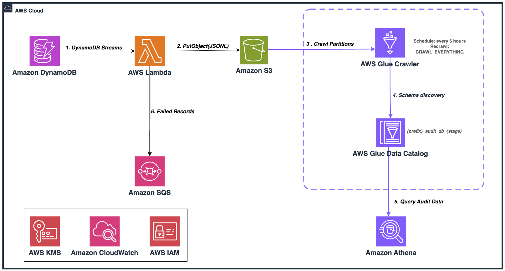

# DynamoDbAuditLogging CDK Construct

A reusable AWS CDK L3 construct that provisions the full DynamoDB audit logging pipeline: DynamoDB Streams → Lambda → S3 (JSONL, Hive-partitioned) → Glue Database + Crawler → Athena.

## Architecture

# DynamoDB AuditLogging L3 Construct

## Architecture Diagram




The construct owns all infrastructure. You own the Lambda handler logic — provide a code path, the construct wires everything else.

## Flow Diagram

The numbered steps in the architecture diagram:

1. **Step 1 — DynamoDB Streams** — every insert, modify, and remove on the source table emits a change record that triggers the Lambda stream processor.
2. **Step 2 — PutObject to Amazon S3** — the Lambda writes each audit event as a JSONL object into the S3 audit bucket under Hive-style `year=/month=/day=/hour=` partitions.
3. **Step 3 — Crawl partitions with Glue Crawler** — on a schedule, the Glue Crawler scans the partitioned S3 prefix.
4. **Step 4 — Schema discovery** — the crawler infers the schema and registers the table and partitions in the Glue Data Catalog.
5. **Step 5 — Query audit data with Athena** — run SQL against the cataloged table, using partition pruning to keep scans fast and cheap.
6. **Step 6 — Failed records to SQS** — stream records that exhaust Lambda retries are sent to the SQS dead-letter queue for later inspection.

## Quick Start

```typescript
import { DynamoDbAuditLogging } from './lib'
import * as dynamodb from 'aws-cdk-lib/aws-dynamodb'

const table = new dynamodb.Table(this, 'MyTable', {
    partitionKey: { name: 'pk', type: dynamodb.AttributeType.STRING },
    stream: dynamodb.StreamViewType.NEW_AND_OLD_IMAGES,
})

const auditLogging = new DynamoDbAuditLogging(this, 'AuditLogging', {
    sourceTable: table,
    lambdaCodePath: './lambda/audit-handler',
    prefix: 'myapp',
    stage: 'prod',
})
```

## Lambda Handler

You provide your own Lambda handler that processes DynamoDB stream events and writes JSONL to S3. The construct injects two environment variables:

- `AUDIT_BUCKET_NAME` — the S3 bucket to write to
- `S3_KEY_PREFIX` — the configured key prefix (default: `audit-data`)

Example handler:

```javascript
const { S3Client, PutObjectCommand } = require('@aws-sdk/client-s3')

const s3 = new S3Client({})
const BUCKET = process.env.AUDIT_BUCKET_NAME
const KEY_PREFIX = process.env.S3_KEY_PREFIX || 'audit-data'

exports.handler = async (event, context) => {
    const records = event.Records.map(record => JSON.stringify({
        eventType: record.eventName,
        eventID: record.eventID,
        timestamp: new Date().toISOString(),
        newImage: record.dynamodb.NewImage || null,
        oldImage: record.dynamodb.OldImage || null,
        keys: record.dynamodb.Keys,
    }))

    const now = new Date()
    const key = `${KEY_PREFIX}/year=${now.getUTCFullYear()}/month=${String(now.getUTCMonth() + 1).padStart(2, '0')}/day=${String(now.getUTCDate()).padStart(2, '0')}/hour=${String(now.getUTCHours()).padStart(2, '0')}/${context.awsRequestId}.jsonl`

    await s3.send(new PutObjectCommand({
        Bucket: BUCKET,
        Key: key,
        Body: records.join('\n'),
        ContentType: 'application/jsonl',
    }))

    return { statusCode: 200, recordsProcessed: records.length }
}
```

## S3 Key Format

```
{s3KeyPrefix}/year=YYYY/month=MM/day=DD/hour=HH/{lambdaRequestId}.jsonl
```

Hive-style partitioning enables automatic partition discovery by Glue Crawler and efficient Athena queries with partition pruning.

## Props

### Required

| Prop | Type | Description |
|------|------|-------------|
| `sourceTable` | `dynamodb.ITable` | DynamoDB table with streams enabled (NEW_AND_OLD_IMAGES) |
| `lambdaCodePath` | `string` | Path to Lambda handler code directory |

### Lambda Configuration

| Prop | Type | Default | Description |
|------|------|---------|-------------|
| `lambdaHandler` | `string` | `'index.handler'` | Lambda handler entry point |
| `lambdaRuntime` | `Runtime` | `NODEJS_22_X` | Lambda runtime |
| `lambdaTimeout` | `Duration` | `5 minutes` | Lambda timeout |
| `lambdaMemorySize` | `number` | `128` | Lambda memory in MB |
| `lambdaEnvironment` | `Record<string, string>` | — | Additional environment variables |
| `lambdaLayers` | `LayerVersion[]` | — | Lambda layers |
| `lambdaReservedConcurrency` | `number` | — | Reserved concurrent executions |
| `lambdaLogRetention` | `RetentionDays` | `ONE_MONTH` | CloudWatch log retention |
| `lambdaVpcConfig` | `{ vpc, securityGroups, subnetSelection? }` | — | VPC configuration |

### Stream Configuration

| Prop | Type | Default | Description |
|------|------|---------|-------------|
| `streamStartingPosition` | `StartingPosition` | `LATEST` | Where to start reading the stream |
| `streamBatchSize` | `number` | `25` | Records per Lambda invocation |
| `streamRetryAttempts` | `number` | `3` | Retry attempts on failure |
| `streamParallelizationFactor` | `number` | `2` | Concurrent batches per shard |
| `streamFilterCriteria` | `FilterCriteria` | — | Event filtering |
| `streamMaximumRecordAge` | `Duration` | — | Max age of records to process |
| `streamBisectBatchOnError` | `boolean` | `false` | Split failed batches |
| `deadLetterQueue` | `sqs.IQueue` | — | DLQ for failed records |

### S3 Configuration

| Prop | Type | Default | Description |
|------|------|---------|-------------|
| `existingAuditBucket` | `s3.IBucket` | — | Bring your own bucket |
| `encryptionKey` | `kms.IKey` | — | KMS key (default: S3-managed) |
| `bucketRemovalPolicy` | `RemovalPolicy` | `RETAIN` | Bucket deletion behavior |
| `s3KeyPrefix` | `string` | `'audit-data'` | S3 key prefix |
| `s3LifecycleRules` | `LifecycleRule[]` | — | Retention/tiering policies |

### Glue Configuration

| Prop | Type | Default | Description |
|------|------|---------|-------------|
| `enableCrawler` | `boolean` | `true` | Create Glue resources |
| `crawlerSchedule` | `string` | `'cron(0 */6 * * ? *)'` | Crawler schedule |
| `crawlerTablePrefix` | `string` | `'audit_'` | Glue table prefix |

### Naming and Tagging

| Prop | Type | Default | Description |
|------|------|---------|-------------|
| `prefix` | `string` | construct id | Resource name prefix |
| `stage` | `string` | `'dev'` | Environment stage |
| `tags` | `Record<string, string>` | — | Custom tags for all resources |

## Exposed Properties

```typescript
auditLogging.auditBucket          // s3.IBucket
auditLogging.streamProcessor      // lambda.Function
auditLogging.streamProcessorRole  // iam.Role
auditLogging.auditDatabase        // glue.CfnDatabase | undefined
auditLogging.auditCrawler         // glue.CfnCrawler | undefined
auditLogging.crawlerRole          // iam.Role | undefined
```

## Querying with Athena

Once the Glue Crawler runs, you can query audit data in Athena:

```sql
-- All audit records
SELECT * FROM {prefix}_audit_db_{stage}.audit_audit_data;

-- Filter by event type
SELECT eventtype, timestamp, keys.pk.S as pk
FROM {prefix}_audit_db_{stage}.audit_audit_data
WHERE eventtype = 'MODIFY';

-- Partition pruning (cost-efficient)
SELECT *
FROM {prefix}_audit_db_{stage}.audit_audit_data
WHERE year = '2026' AND month = '05' AND day = '10';

-- Changes for a specific record
SELECT eventtype, timestamp, newimage.role.S as new_role, oldimage.role.S as old_role
FROM {prefix}_audit_db_{stage}.audit_audit_data
WHERE keys.pk.S = 'user-001';
```

## Resource Naming

| Resource | Pattern |
|----------|---------|
| S3 Bucket | `{prefix}-audit-{stage}-{account}` |
| Lambda Function | `{prefix}-audit-stream-processor-{stage}` |
| Lambda Role | `{prefix}-audit-stream-processor-role-{stage}` |
| Glue Database | `{prefix}_audit_db_{stage}` |
| Glue Crawler | `{prefix}-audit-crawler-{stage}` |
| Crawler Role | `{prefix}-audit-crawler-role-{stage}` |

## Security

- S3 bucket: encrypted (S3-managed or KMS), public access blocked, SSL enforced
- Lambda role: least-privilege (CloudWatch Logs, S3 PutObject/GetObject/ListBucket only)
- Crawler role: `AWSGlueServiceRole` + scoped S3 read
- CDK Nag suppressions included with documented reasons

For the full security posture, Checkov finding dispositions, and guidance on running scans, see [SECURITY.md](./SECURITY.md).

## Validation

The construct validates props at synth time:

- `sourceTable` must have DynamoDB Streams enabled
- `existingAuditBucket` cannot be combined with `encryptionKey`
- `existingAuditBucket` cannot be combined with `s3LifecycleRules`
- `streamBatchSize` must be between 1 and 10,000
- `streamParallelizationFactor` must be between 1 and 10

## Testing

```bash
# Run all tests (unit + property-based)
npm test

# Run specific test file
npx vitest run test/validation.property.test.ts

# Build
npm run build
```

The test suite includes:
- Property-based tests (fast-check, 100+ iterations per property)
- Unit tests using `aws-cdk-lib/assertions`
- CDK Nag compliance tests

## Cost Optimization

- Batch size (default 25) reduces Lambda invocations
- Hive partitioning cuts Athena scan costs via partition pruning
- `s3LifecycleRules` for automatic tiering to Glacier or expiration
- `enableCrawler: false` eliminates Glue Crawler DPU costs
- `lambdaLogRetention` (default 1 month) caps CloudWatch storage
- S3-managed encryption by default avoids KMS per-request charges

## License

This project is licensed under the Apache-2.0 License. See the [LICENSE](./LICENSE) file for details.

See [CONTRIBUTING](./CONTRIBUTING.md) for guidance on contributing, and [CODE_OF_CONDUCT](./CODE_OF_CONDUCT.md) for the code of conduct.
